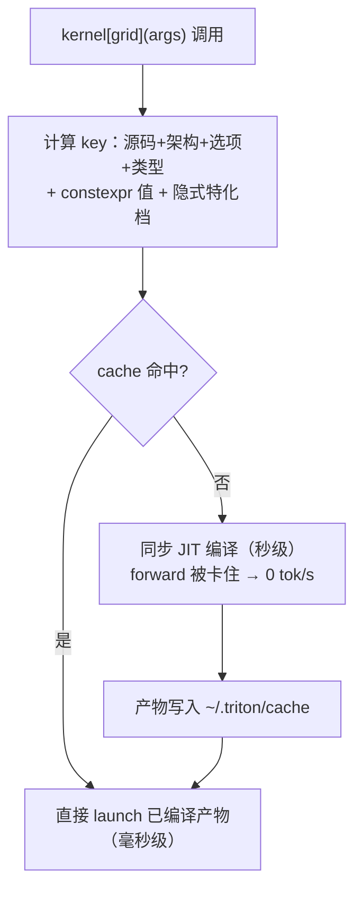
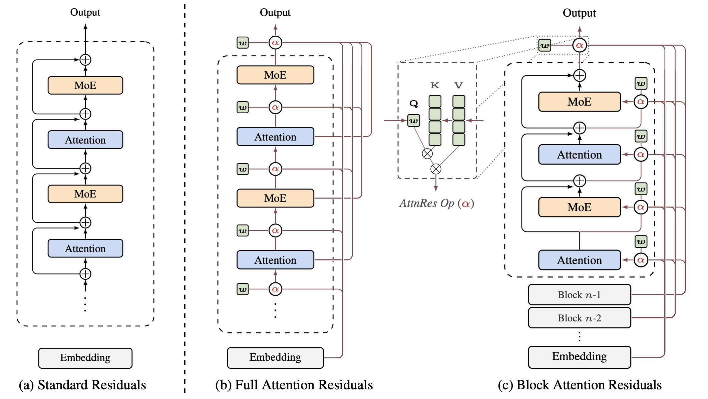
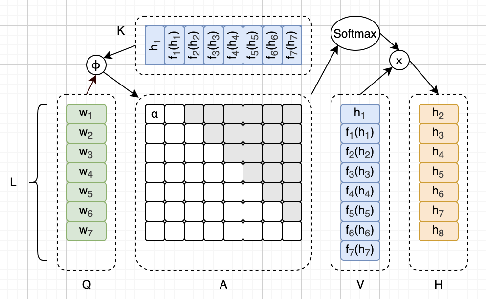

# Triton JIT 编译特化机制与 Kimi K3 attention-residual kernel 详解

## 1. 问题背景

kimi-k3-main-pd-1m 任务（PD 分离 4P+4D、TP16/DP4/DCP16、MRV2 栈）的 P 侧 prefill 性能波动很大：三轮 online_20k_40k duration 657→504s，TTFT p50 大幅波动，R8 分析发现"P 引擎 duty cycle ~32%、每请求有效 prefill 速率仅 ~1076 tok/s（引擎能力 4000 tok/s）"。深入排查实锤根因：**P 侧每个新 chunk 形状都会触发 `_apply_attn_res_kernel` 的 Triton JIT 重编译**，每次编译秒级停顿，编译时刻与引擎 0 tok/s 吞吐窗口精确对齐。

**触发问题**：chunked prefill 变长输入下，triton kernel 把运行时数据量（token 数）声明为 `tl.constexpr`，导致每 chunk 一次 JIT 编译、服务期持续重编译。

**涉及模块**：vllm-ascend `vllm_ascend/ops/triton/kimi_k3/attention_residual.py`（kernel 本体）、`vllm_ascend/models/kimi_k3.py`（调用方）、triton-ascend JIT 编译缓存（`~/.triton/cache`）。

---

## 2. 核心知识：Triton JIT 编译与特化机制

### 2.1 Triton 是什么

写 kernel（算子的设备代码）有两条路：

- **原生 C/C++ + 硬件编译工具链**（NVIDIA CUDA C / 昇腾 CANN CCE）：性能最好，但门槛高、开发慢；
- **Triton**：用 Python 语法写 kernel，编译器代管底层细节（线程映射、向量化、内存合并）。写的仍是"每个并行单元各自做什么"的 kernel 级代码，但体验接近写 numpy。

昇腾上跑的是 **triton-ascend**（Triton 的昇腾 NPU 后端）；vllm-ascend 的 `vllm_ascend/ops/triton/**.py` 就是 Triton kernel 源码，例如本篇的 `attention_residual.py`。

**并行编程模型**：一次 launch 启动一批"程序实例"（program，类比"工人"），每个实例拿编号 `tl.program_id(0)`，各自处理数据的一小段。`kernel[(grid,)](args)` 中括号里就是 grid（启动多少个实例）。本 kernel 启动 `NUM_CORES`（A3 向量核数）个程序，每个程序按 `block_size` 分摊一段 token。

**标量 vs 向量思维**：Triton 变量分两种——标量（一个数）与向量（一整块）。`tl.arange(0, n)` 生成向量索引后，`ptr + cols` 一次读一整行。**向量没有"只改第 s 个元素"的语法**，所以往向量某格写/读一个数，都用 `tl.where(s_idx == s, ...)` 掩码模式，本质是"把向量的第 s 格替换成新值，其余格保持原样"。

### 2.2 三个必须先认识的 Triton 语法件


| 语法                                | 干什么                       | 小白类比                                       |
| --------------------------------- | ------------------------- | ------------------------------------------ |
| `tl.arange(0, n)`                 | 生成向量索引 `[0,1,…,n-1]`，宽度 n | "一次性拿到 n 个下标"，之后 `ptr + cols` 读的是一整行而不是一个数 |
| `tl.load(ptr) / tl.store(ptr, x)` | 显式读/写显存                   | Triton 里没有自动取数（不像 PyTorch），读写都要点名          |
| `tl.where(cond, a, b)`            | 按元素挑值                     | 向量版的 `mask ? a : b`                        |


### 2.3 `@triton.jit` 与 JIT 编译机制

`@triton.jit` 装饰的函数是**源码形态**，不能直接执行。第一次以某组参数调用时，Triton 才把它编译成设备二进制（昇腾上是 CCE 编译的 aicore 二进制），然后启动；之后再用**"同样形态"的参数**调用，直接复用已编译产物。类比 PyTorch 很少见的体验：**第一次调用一个算子要等几秒（编译），后面才是微秒级**。实测（A3）：本 kernel 每个新变体编译 **2.5~3.6 秒**。

**编译发生在哪，决定了它伤不伤服务**：launch 是同步的——查缓存 → 未命中就在当前 Python 线程里原地编译（秒级）→ 再启动。也就是说**推理引擎的 forward 会被编译原地卡住**，这是"重编译卡死 prefill"的机制根源。

### 2.4 编译缓存 key：什么决定"要不要重新编译"

Triton 给每个编译产物算一个 **hash**，命中就复用、不中就编译。key 大致由这些构成：


| key 成分                           | 变化频率                   |
| -------------------------------- | ---------------------- |
| kernel 源码文本                      | 改代码才变                  |
| 目标硬件架构                           | 不变                     |
| 编译选项（num_warps/num_stages…）      | 不变                     |
| 每个参数的数据类型                        | 不变                     |
| `**tl.constexpr` 参数的值**          | **值一变 = 新 key = 重新编译** |
| **非 constexpr 标量的隐式特化档位**（见 2.6） | 跨档 = 新 key             |


`~/.triton/cache` 下一堆乱码目录名，每个就是一个 key 的 hash，里面躺着该组合的编译产物。Round 9 排查数的"1200 个变体"，本质就是 **1200 个不同的 hash**。

**修复前后行为对比**（同一批请求的 chunk 序列）：

- 修复前：chunk1 `(N=8192, B=3)` → 编译一次；chunk2 `(N=4127, B=3)` → **又编译**；涓流小批 `(N=17, B=5)` → **又编译**……每个新 N 值都编，永不停止（2 小时后还在编）；
- 修复后：`N=8192 / 4127 / 17` 共用同一个二进制（N 作为运行时标量传进去），只有 B 变化才可能触发新编译，而 B 值域 {0..8} 有界。

### 2.5 `tl.constexpr`：tile shape 还是数据量

`tl.constexpr` 把值**烤进编译产物**（类比 C++ 的 `template<int N>` 或 `#define`）：值即身份，值变 = 换了一个模板实例 = 重新实例化（对应 Triton 就是重新编译）。编译器拿它能做激进优化：展开循环、确定向量宽度、常量折叠。

**什么时候该用 constexpr？判据是"tile shape 还是数据量"**：

- 决定代码**结构**的量（tile 大小、向量宽度、循环展开次数、地址步进）→ constexpr，编译器靠它生成好代码；
- 只是**数据多少**的量（本批 token 数、序列长度）→ 运行时参数，值变了硬件执行同一份代码就行。

对照本 kernel 参数表：


| 参数                    | 性质                            | 该不该 constexpr             |
| --------------------- | ----------------------------- | ------------------------- |
| `H`（hidden_size=7168） | 模型常数，决定 `tl.arange(0,H)` 向量宽度 | ✓ 必须是（tile shape）         |
| `BLOCK_CAPACITY`      | 模型常数，决定残差块的地址步进               | ✓                         |
| `EPS`、`NUM_CORES`     | 模型/硬件常数                       | ✓                         |
| `NB`                  | `arange(0,NB)` 的宽度，必须是 2 的幂   | ✓ 必须是（tile shape）         |
| `B`                   | 有效残差块数，**模型结构常数**（见 4.2）      | 可 constexpr（PR 16006 的选择） |
| `N`（num_tokens）       | **每批数据量，运行时任意**               | ✗ 不该是——这就是 bug            |


N 在函数体里只做三件事：算分摊量、判空转、切区间边界——**全是标量运算，编译器并不需要编译期知道它是几**。把这种量做成 constexpr，得到的唯一"优化"是编译器知道 N 具体是几，而它拿这个信息能省的东西约等于零，代价却是每个新值重编一次。**纯亏**。

`**do_not_specialize` 的代价**：放弃隐式特化的优化。对本 kernel 无感——N 不定义 tile shape，编译器本来就从它身上榨不出什么油水。

### 2.6 隐式特化：不标 constexpr 也可能按值分档

Triton 对**没标 constexpr 的标量 int 参数**也有默认行为：按值的特征悄悄分三档——

- `值 == 1`：一档（"恒为 1"可以折叠掉 if 分支）；
- `值 % 16 == 0`：一档（对齐信息利于向量化访存）；
- 其他：一档。

同一参数跨档 = 不同 key = 重新编译。所以修复是**两步缺一不可**：

1. `N: tl.constexpr` → `num_tokens`（运行时标量）：从"每个值一个变体"降到"3 个隐式档"；
2. `do_not_specialize=["num_tokens"]`：把这 3 个隐式档也关掉，任意 token 数共享**同一个**二进制。

PR 16006 的回归测试专门挑 `(1, 7, 16, 17, 512)` 五个值，就是精确踩这三个隐式档（1 是 value-one 档、16 是对齐档、7/17/512 是普通档）。

### 2.7 重编译为什么恰好表现成"prefill 波动"（因果链）

1. 新请求的 chunk token 数 N 没见过 → launch 时 cache miss → **同步编译 2.5~3.6s**，这期间该引擎 forward 完全停住（prefill 是算力型阶段，一停就 0 tok/s）；
2. 编完恢复 2000~5000 tok/s，直到下一个新 (N,B) 出现——实测每个编译批次都精确对一个 0 tok/s 窗口；
3. 4 台 DP 引擎各分到不同请求序列 → 各自踩不同的 N 组合 → 波动不同步，单台内看就是随机抖动；
4. 跑过的组合进了 `~/.triton/cache`（跨进程持久），所以 warm 轮明显好于冷轮——实验中"预热效应"有一部分来自它；
5. 修复后（N 不进 key）：N 随便变都命中同一 hash，1~~8192 任意值首调毫秒级（实测 0.2~~52ms）。

---

## 3. 原理说明

### 3.1 kernel launch 的查缓存路径



关键点：cache 命中与否完全由 key 决定；把"运行时数据量"留在 constexpr 集合里，等于让 key 随输入无限膨胀。

### 3.2 specialization 爆炸的量化模型

变体数 ≈ ∏(各 constexpr 参数的取值空间)。原始 kernel 中：

- `N`（num_tokens）：chunked prefill 变长输入下任意值（满块 8192 + 任意余量 + 涓流小批）→ **无界**；
- `B`（num_valid_blocks）：`cdiv(layer_idx, attn_res_block_size)`，K3 为 93 层/block=12 → B ∈ {0..8}，**模型结构常数**；
- 其余参数模型/硬件常数 → 1 档。

所以只把 N 移出编译 key，重编译就从"无界"变"有界"（B 的 8 个变体一次 forward 穿 93 层全部触发，启动 dummy run 里编完收敛）；若 B 也运行时化则只剩 NB 档 {2,4,8,16} 共 4 个变体。

---

## 4. 实战案例：Round 9 实测 + PR 16006 + 本地修复

### 4.1 Round 9 实测数据（2026-09-29，MRV2 栈服务 06:58 启动、bench 窗口 07:00-09:02）


| 证据                                    | 数据                                                                                                                                                                                                      |
| ------------------------------------- | ------------------------------------------------------------------------------------------------------------------------------------------------------------------------------------------------------- |
| 4 台 p 节点 `_apply_attn_res_kernel` 变体数 | p0=1200 / p1=1194 / p2=1170 / p3=1250（各占 cache 总条目 ~86%）                                                                                                                                                |
| bench 窗口内持续新增                         | 07 点每台 +48~~72、08 点 +17~~25；编译批次 07:13/07:15/07:16/07:28/07:38/08:28/08:39，每批 ~8 个新变体（一个 forward 内多层 B 档不同）                                                                                             |
| 编译时刻 vs 吞吐塌方                          | 每个编译时刻精确对应 0.0 tok/s 窗口（前后均 2000-5400 tok/s）；07:11-07:43 累计 0 吞吐 ≥400s                                                                                                                                  |
| 排查手段                                  | `find ~/.triton/cache -maxdepth 1 -type d -printf "%TY-%Tm-%Td_%TH\n" | sort | uniq -c`（按小时统计变体生成）；`find -name "*.json" -printf` 按 kernel 名（json 文件名）分桶；cache json 元数据不直接列 constexpr 值（编码进 hash），需回源码确认 |


### 4.2 社区 PR 16006 详解

`https://github.com/vllm-project/vllm-ascend/pull/16006`：`[v0.27.1rc][Performance][Kimi K3] Avoid attention-residual token-count specialization`，作者 Dawn952，2026-09-08 提交、09-13 合入 `releases/v0.27.1rc`（merge commit `9272234d7`），2 commits +27/-7（`attention_residual.py` 12 行 + 测试 22 行）：

```python
- @triton.jit
+ @triton.jit(do_not_specialize=["num_tokens"])   # 关掉隐式分档
  def _apply_attn_res_kernel(...):
-     N: tl.constexpr,          # 值烤进二进制 → 每值一编译
+     num_tokens,               # 运行时标量
```

函数体内三处同步替换（`block_size = (num_tokens-1)//NUM_CORES+1`、`tok0 >= num_tokens`、`tok1 = tl.minimum(..., num_tokens)`），host 调用 `N=num_tokens` → `num_tokens=num_tokens`（仅参数名对齐，传值不变）。**数学零变化、代码结构零变化**，变的只有"N 参不参与编译 key"。`N` 顺手改名 `num_tokens` 是可读性——它不是 batch size，是 token 数。

**B 与 H/BLOCK_CAPACITY/EPS/NUM_CORES/NB 全保留 constexpr**——B 是模型结构常数（{0..8}）且有界：`for s in range(B+1)` 保持编译期完全展开（`if s < B` 的真假编译期判掉，每次迭代只剩一个 load——零空转）、`tl.static_assert` 仍可用，且一次 forward 穿 93 层就会把全部 B 档编完（V1 启动 dummy run 天然吸收），服务期零重编译。

**测试巧思**：`kernel[grid](args)` 这行 Python 最终落到 `JITFunction.run(...)`——它查 key、决定复用或编译、返回**编译后的 kernel 对象**。测试把 `run` 换成记录版（monkeypatch），跑 token 数 `(1, 7, 16, 17, 512)`（精确覆盖 ==1 档、%16 对齐档、普通档），断言 `all(kernel is kernels[0])`——**同一个 Python 对象 = 编译只发生过一次**。比数 cache 目录更硬：对象身份不受文件系统、并发进程、缓存清理的干扰，直接验证"launch 没走编译路径"。

**重要事实**：该 PR **不在 `kimi-k3-main-pd-1m` 分支线上**（`git branch --contains 9272234d7` 无此分支），main-pd-1m（v0.29.1rc0 内仓线）未包含此修复，因此该栈持续踩坑——本地修复（4.3）在这条线上不是重复劳动。

### 4.3 本地修复（worktree kimi-k3-attn-res-fix，分支基于实验栈 279283684）


| 维度                            | PR 16006              | 本地 commit `80bb08215` + `ef09d6074`                   |
| ----------------------------- | --------------------- | ----------------------------------------------------- |
| N 运行时化                        | ✓（+do_not_specialize） | ✓（+do_not_specialize）                                 |
| B 处理                          | 保留 constexpr          | 也运行时化 + `range(NB)` 全档掩码循环（padding 档保 -inf score/零权重） |
| 剩余变体（K3 实配）                   | ~8 个（每 B 值一个）         | 4 个（NB∈{2,4,8,16}）                                    |
| 循环结构                          | 原样 `range(B+1)`，零空算   | `range(NB)` 掩码，NB ≤ 2(B+1)，有 padding 空算               |
| 数值风险                          | 极低（循环逻辑零改动）           | 较高（掩码语义，已 9/9 数值验证 PASS）                              |
| 预热                            | 无（dummy run 天然编满 B 档） | `warmup_apply_attn_res()` 首次 forward 惰性触发 + 环境变量开关    |
| `tl.static_assert(NB >= B+1)` | 保留（B 编译期可判）           | 必须删除（B 运行时化后编译期断言失效），由 host 端 `next_power_of_2` 数学保证  |


jinqi01（新申请 16card A3 机器，k3-p0 同款镜像）验证：数值 9/9 PASS（N=1..1000、B=1..8 全 4 档，rtol/atol=1e-2）；首遍 12 组 shape 仅新增 4 个变体（各 2.5-3.6s）；第二遍零新增（12 case 共 0.16s）；干净 cache 子进程 warmup 11.96s 编满 4 档后任意 shape 首调 0.2-52ms 无 JIT。

---

## 5. `_apply_attn_res_kernel` 逐行详解

### 5.1 语义背景：这个 kernel 在模型里算什么

Kimi K3 是混合架构模型（Mamba 块 + attention 层交替）。它的残差不是传统 Transformer 的"单一 residual 流"，而是：每 12 层（`attn_res_block_size`）把中间结果存成一个**块残差**（`block_residual`，最多 8 块），同时维护一条**前缀和残差**（`prefix_sum`）。每个 token 到达 attention/MLP 之前，要把这 B 个块残差 + 1 条前缀和做一次"学会的加权混合"：

```
对每个 token：
  ① 每条流（B 个块残差 + 1 个前缀和，共 B+1 条）各自 RMS 归一化   → 统一量纲
  ② 归一化后的流与同一组权重 w 点积 → B+1 个分数                  → "每条流有多重要"
  ③ 分数做 softmax → B+1 个权重（和为 1）
  ④ 用这组权重把 B+1 条原始流加权求和 → 输出 1 条
```

数据形状（K3 实配）：`block_residual [num_tokens, 8, 7168]`、`prefix_sum [num_tokens, 7168]`、输出 `[num_tokens, 7168]`。

### 5.2 RMS 归一化与 EPS 是什么

RMSNorm（Root Mean Square Normalization）是 LayerNorm 的轻量变体：**不减均值，只按均方根缩放**。公式：

```
k = v / √(mean(v²) + eps)
```

kernel 里三行对应：

```python
ms   = tl.sum(v * v) / H        # 均方值 mean square
rstd = tl.rsqrt(ms + EPS)       # 1/√(ms+eps)，root-mean-square 的倒数
k    = v * rstd                 # 归一化后的这条流
```

**eps（1e-6）的作用：防除零/数值稳定**。当 v 全零（残差块未初始化或 padding 格）时 ms=0，`√0=0` → `1/0=inf` 会把后续计算炸成 NaN；加 eps 后 `rstd = 1/√eps` 仍是有限值。1e-6 来自模型配置 `config.rms_norm_eps`，所有 RMSNorm 层共享同一常数——这也是 `EPS` 适合 constexpr 的原因（模型常数，永不产生变体）。

**为什么每条流要先 RMS 归一化**：B+1 条流来自不同深度的层（第 0/12/24… 层的中间结果），幅度量纲差异大，直接比"内积分数"不公平——先各自归一到单位 RMS 再打分，softmax 才真正反映"语义重要性"而不是"谁的数值大"。

### 5.3 NB 是什么

`NB = next_power_of_2(B + 1)`。其中 **B+1 = 参与混合的流数**（B 个块残差 + 1 条前缀和）。

- **为什么不能直接等于 B+1**：NB 是 `tl.arange(0, NB)` 的宽度，而 `tl.arange` 生成的向量宽度**必须是 2 的幂**（Triton 硬性要求——向量寄存器/硬件对齐是 tile shape 的一部分）。所以 B+1 向上取最近的 2 的幂；
- **为什么必须 NB ≥ B+1**：格子要装得下所有流编号 0..B，装不下就漏流；多出来的格子是 padding 档；
- **padding 档（s ∈ [B+1, NB)）的闭环处理**：scores 初始化全 -inf → padding 格不写入（原版 `range(B+1)` 根本不迭代它；修复版 `range(NB)` 用 `& (s <= B)` 掩码跳过）→ softmax 时 `exp(-inf - max) = 0` → 权重 0 → 无害。"用 -inf 初始化"与"padding 无害"在这里闭环；
- **NB 档位实例表（K3，B ∈ [1,8]）**：


| B（有效块数） | 流数 B+1 | NB  | padding 格数 |
| ------- | ------ | --- | ---------- |
| 1       | 2      | 2   | 0          |
| 2~3     | 3~4    | 4   | 1~0        |
| 4~7     | 5~8    | 8   | 3~0        |
| 8       | 9      | 16  | 7          |


- **NB 档位 = 修复后唯一的形状 constexpr**：B 运行时化后 NB 仍必须 constexpr（arange 宽度是 tile shape，编译期才知道向量多宽）——这就是"修复后还有 4 个变体而不是 1 个"的原因。NB 档数 ≈ log2(block_capacity)+1，由模型结构决定（K3 = 4 档）。

### 5.4 分段拆解

**第 1 段：签名——5 根指针 + 7 个编译期常量**。指针参数是 tensor 首地址，每次调用传实际地址（只有类型进 key）；constexpr 参数的值烤进编译产物，任一值变 = 新 key。NB 必须 constexpr 因为它是 arange 宽度（5.3）。

**第 2 段：把 N 个 token 均分给 NUM_CORES 个"工人"**。`block_size` 向上取整（`(N-1)//NUM_CORES+1`）；`pid` 是本工人编号；`tok0/tok1` 是我负责的区间；`if tok0 >= N: return` 处理活不够分的空转。**N 在这里只做三件事：算分摊量、判空转、切边界——全是运行时就能算的标量运算，编译器并不需要编译期知道它是几**（这就是"N 标 constexpr 纯亏"的直接证据，也是 PR 16006 改动的全部动机）。

**第 3 段：准备向量索引与行权重**。`cols = tl.arange(0, H)` 让 `ptr + cols` 一次读一整行 7168 个数；`block_residual_stride = BLOCK_CAPACITY * H` 是跨一个块要跳过的元素数；两个权重提前乘好（`w = norm_w * proj_w`），因为它们对每个 token 都一样，放循环外只算一次；`.to(tl.float32)` 把 bf16 升精度再算（数值安全）。

**第 4 段：主循环（逐 token）**。`for tok in range(tok0, tok1)` 是运行时边界的循环（tok0/tok1 是运行时值）。

- **地址三层定位**：`block_residual_ptr + tok * block_residual_stride`（到该 token 的块区起点）`+ s * H`（到第 s 块）`+ cols`（读完 7168 个数）；
- **掩码写**：`scores = tl.where(s_idx == s, tl.sum(k * w), scores)` = "第 s 格更新成这个分数，其余格不动"——向量没有单格赋值语法，`tl.sum(k*w)` 是点积标量分数；
- **softmax 数值稳定**：先减 `scores_max` 再 exp，防溢出；padding 格 `exp(-inf - max) = 0`；
- **掩码读**：`w_s = tl.sum(tl.where(s_idx == s, weights, 0.0))` = "其余格置 0 后求和 = 抠出第 s 格的标量权重"——掩码模式的反用；
- **加权累加用未归一化的原始流 v**（打分用归一化的 k，混合用原始 v）；
- **写回**：`out.to(out_ptr.dtype.element_ty)` 按"输出指针的 dtype（bf16）"转换，避免硬编码类型；
- **B constexpr 的福利**：`for s in range(B+1)` 编译期完全展开，`if s < B` 真假编译期判掉，每次迭代只剩一个 load——这也是 PR 16006 保留 B 的考量之一。

**两遍流循环不能合并**：softmax 需要先集齐全部 B+1 个分数（要全局 max 和 sum），必须"先全部打分 → softmax → 再回来加权"。

### 5.5 逐行注释版

```python
@triton.jit  # 标记为 Triton kernel：首次调用按参数组合编译并缓存
def _apply_attn_res_kernel(
    block_residual_ptr,     # in: 块残差 [N, block_capacity, H] 首地址
    prefix_sum_ptr,         # in: 前缀和残差 [N, H] 首地址
    norm_w_ptr,             # in: RMSNorm 权重 [H]
    proj_w_ptr,             # in: 投影权重 [1, H]
    out_ptr,                # out: 输出 [N, H]
    N: tl.constexpr,        # 本批 token 数（PR16006：改运行时 + do_not_specialize）
    H: tl.constexpr,        # hidden=7168，决定向量宽度，必须编译期
    B: tl.constexpr,        # 有效块数 0~8（模型结构常数）
    BLOCK_CAPACITY: tl.constexpr,  # 块容量=8
    EPS: tl.constexpr,      # RMS eps=1e-6（防除零，模型常数）
    NUM_CORES: tl.constexpr,        # 启动的核/程序数
    NB: tl.constexpr,      # 向量格数=next_pow2(B+1)，arange 宽度必须编译期
):
    # 编译期断言：NB 装得下 B+1 条流
    tl.static_assert(NB >= B + 1, "NB must include all block residuals and prefix_sum")
    # 每个核分摊的 token 数（向上取整）
    block_size = (N - 1) // NUM_CORES + 1
    pid = tl.program_id(0)      # 本程序实例编号
    tok0 = pid * block_size    # 我负责的 token 区间左端
    if tok0 >= N:              # 活不够分：尾号核空转退出
        return
    tok1 = tl.minimum(tok0 + block_size, N)  # 右端截断到 N
    # 行内下标向量（一次读写整行 7168 个数）
    cols = tl.arange(0, H)
    # "流编号"向量（掩码写入/读出用）
    s_idx = tl.arange(0, NB)
    # block_residual 中跨一个块要跳过的元素数
    block_residual_stride = BLOCK_CAPACITY * H

    norm_w = tl.load(norm_w_ptr + cols).to(tl.float32)  # RMSNorm 权重一行，升 fp32
    proj_w = tl.load(proj_w_ptr + cols).to(tl.float32)  # 投影权重一行，升 fp32
    w = norm_w * proj_w     # 预乘，循环外只算一次

    for tok in range(tok0, tok1):        # 逐 token（运行时边界）
        scores = tl.full([NB], -float("inf"), dtype=tl.float32)  # 分数向量，全 -inf（padding 格天然淘汰）

        for s in range(B + 1):           # 遍历 B+1 条流（编译期展开）
            if s < B:                    # 前第 s 块残差
                v = tl.load(block_residual_ptr + tok * block_residual_stride + s * H + cols).to(tl.float32)  # 整行读入
            else:                        # 第 B 条流 = 前缀和
                v = tl.load(prefix_sum_ptr + tok * H + cols).to(tl.float32)
            ms = tl.sum(v * v) / H       # 均方值
            rstd = tl.rsqrt(ms + EPS)    # 1/√(ms+eps)
            k = v * rstd                 # RMS 归一化后的流
            scores = tl.where(s_idx == s, tl.sum(k * w), scores)  # 掩码写：k·w 分数写入第 s 格

        scores_max = tl.max(scores)              # softmax 数值稳定：先减 max
        exp_scores = tl.exp(scores - scores_max)  # padding 格 exp(-inf)=0
        weights = exp_scores / tl.sum(exp_scores)  # 归一化 → 混合权重（和为 1）

        out = tl.zeros([H], dtype=tl.float32)   # 加权累加器，一行
        for s in range(B + 1):                   # 第二遍遍历流
            if s < B:                            # 同上：第 s 块
                v = tl.load(block_residual_ptr + tok * block_residual_stride + s * H + cols).to(tl.float32)
            else:                                # 前缀和
                v = tl.load(prefix_sum_ptr + tok * H + cols).to(tl.float32)
            w_s = tl.sum(tl.where(s_idx == s, weights, 0.0))  # 掩码读：抠出第 s 格权重标量
            out += w_s * v                       # 累加 权重×原始流（未归一化）

        tl.store(out_ptr + tok * H + cols, out.to(out_ptr.dtype.element_ty))  # 写回该行，转输出 dtype
```

### 5.6 Block AttnRes 算法：伪代码逐行解释

§5.1~§5.5 讲的是 vllm-ascend 的 kernel 实现。本节回到算法本身——Kimi K3 用的 Block AttnRes 到底在算什么。下面这段是论文（arXiv:2603.15031）里的参考伪代码，kernel 正是它的逐 token 展开。

**整体思路**：标准残差是"前面所有层输出固定加 1 累加"（深度维度的 RNN）；Block AttnRes 把层分成若干块，**每个子层（attn 前、MLP 前）都对"所有已完成块 + 当前块部分和"做 softmax 注意力加权读取**——块内块间没有区别。区别只在**块边界处才把当前部分和提交成新块**（`blocks.append`），把注意力作用的候选数从 O(L) 降到 O(N)，从而把显存/通信开销从 O(Ld) 降到 O(Nd)。这样每层不再无差别吸收所有历史，而是按内容选择性读取"哪些块更重要"。



*图 1：三种残差结构对比（来源：[MoonshotAI/Attention-Residuals](https://github.com/MoonshotAI/Attention-Residuals) `assets/overview.png`）。(a) Standard Residuals：固定权重加法累加；(b) Full AttnRes：每个子层学一个注意力权重，选择性聚合所有前序子层输出；(c) Block AttnRes：层分块，**每个子层都做注意力读取**（对"所有已完成块 + 当前块部分和"加权），区别只在*块边界处才把当前部分和提交成新块*（`blocks.append`）。这样把注意力作用的候选数从 O(L) 降到 O(N)，显存/通信从 O(Ld) 降到 O(Nd)。K3 用的就是 (c)。*

**计算过程**：每条流的 key 是 RMSNorm 后的层输出，value 是原始层输出，query 是该层可学习的伪查询向量 w（单头、逐位置共享）。注意力权重 α 由 softmax 归一化，再对原始 value 加权求和得到该层输入 h。



*图 2：AttnRes 计算过程（来源：[知乎专栏](https://zhuanlan.zhihu.com/p/2066821576473982490)）。Q = 各层伪查询 w（绿色，L 个），K = RMSNorm(各层输出)（蓝色），V = 原始各层输出（蓝色），A = softmax(QKᵀ) 深度注意力矩阵（灰色下三角），H = 加权求和后的各层输入。注意这里的"层"在 Block AttnRes 里被替换成"块表示 + 当前块部分和"。*

伪代码：

```python
def block_attn_res(blocks, partial_block, proj, norm):
    V = torch.stack(blocks + [partial_block])        # [N+1, B, T, D]
    K = norm(V)                                       # RMSNorm 每条流
    logits = einsum('d,nbtd->nbt', proj.weight.squeeze(), K)   # 伪查询点积打分
    h = einsum('nbt,nbtd->btd', logits.softmax(0), V)  # softmax 加权求和
    return h

def forward(self, blocks, hidden_states):
    partial_block = hidden_states
    h = block_attn_res(blocks, partial_block, self.attn_res_proj, self.attn_res_norm)  # attn 前读取
    if self.layer_number % (self.block_size // 2) == 0:   # 到块边界
        blocks.append(partial_block)                       # 提交当前块
        partial_block = None                               # 开新块
    attn_out = self.attn(self.attn_norm(h))
    partial_block = partial_block + attn_out if partial_block is not None else attn_out
    h = block_attn_res(blocks, partial_block, self.mlp_res_proj, self.mlp_res_norm)  # MLP 前再读取
    mlp_out = self.mlp(self.mlp_norm(h))
    partial_block = partial_block + mlp_out
    return blocks, partial_block
```

逐行解释：

`**block_attn_res`（一次"块间读取"）**

- `V = torch.stack(blocks + [partial_block])`：`blocks` 是 N 个已完成块表示（各 `[B,T,D]`），`partial_block` 是当前块的部分和 `b_n^i`。list 拼接 + stack 得到 `[N+1, B, T, D]`，即 N+1 条候选流（N 块 + 1 部分和）。这就是 kernel 里 `block_residual[tok, s, :]`（s&lt;B）和 `prefix_sum[tok, :]`（s==B）两路 load 的来源。
- `K = norm(V)`：对每条流做 RMSNorm 得到 key。作用是把不同深度、不同块的表示拉到同一量纲，避免幅值大的块主导打分。对应 kernel 里 `k = v * rstd`。
  - `logits = einsum('d,nbtd->nbt', proj.weight.squeeze(), K)`：`proj` 是 `Linear(D,1)`，`weight.squeeze()` 得 `[D]` 伪查询 w。与 K 点积得 `[N+1,B,T]` 分数——每个 token 位置、每条流一个标量。对应 kernel 里 `tl.sum(k * w)`。**注意没有 1/√D 缩放**。
- `h = einsum('nbt,nbtd->btd', logits.softmax(0), V)`：`softmax(0)` 在流维度归一，再对**未归一化**的 V 加权求和。h 是凸组合（权重和为 1），幅值有界——这是与标准残差"线性增长"的本质区别。对应 kernel 里 softmax + `out += w_s * v`。

`**forward`（一个 Transformer 层）**

- `partial_block = hidden_states`：上一层返回的部分和，本层继续累加。
- 第一次 `block_attn_res(...)`：进 ATTN 前先做一次块间读取，用 ATTN 子层专属的 `attn_res_proj/norm`。
- `if self.layer_number % (self.block_size // 2) == 0:`：块边界判断。伪代码里 `block_size` 按**子层**计数（ATTN+MLP 各算 1），所以一个块 = `block_size//2` 层。**注意**：K3 config 里的 `attn_res_block_size=12` 按**层**计数，等价于伪代码 `block_size=24`（2×12）。两套口径描述同一个结构：每 12 层封一块。
- `blocks.append(partial_block); partial_block = None`：把累计完的部分和提交为新块（就地 append，调用方可见），然后置空开新块。
- `attn_out = self.attn(self.attn_norm(h))`：标准 pre-norm 自注意力，但输入是读取结果 h 而非传统残差流。
- `partial_block = partial_block + attn_out if partial_block is not None else attn_out`：普通层继续累加；刚过边界的层（partial=None）直接从 attn_out 起步新块。
- 第二次 `block_attn_res(..., mlp_res_proj, mlp_res_norm)`：进 MLP 前再读取一次，用 MLP 子层**独立的另一组** proj/norm。
- `mlp_out = self.mlp(self.mlp_norm(h)); partial_block = partial_block + mlp_out`：MLP 输出累进部分和，传给下一层。

**关键不变式**：每次读取看到的都是"全部已完成块 + 当前 partial，各恰好一次"。边界层"先读、再提交、再算 attn"的顺序保证了这一点——刚完成的块在第一次读取里以 partial 身份出现，在 MLP 读取里以已提交块身份出现，不重复计数。

**与 kernel 的对应关系**：


| 伪代码                        | kernel 实现                                                    |
| -------------------------- | ------------------------------------------------------------ |
| `blocks + [partial_block]` | `block_residual[tok,s,:]`（s&lt;B）+ `prefix_sum[tok,:]`（s==B） |
| `norm(V)`                  | `k = v * rstd`（RMSNorm）                                      |
| `proj.weight.squeeze()` 点积 | `tl.sum(k * w)`，w = norm_w × proj_w                          |
| `logits.softmax(0)`        | `tl.exp(scores - max) / sum`                                 |
| `einsum('nbt,nbtd->btd')`  | `out += w_s * v` 循环累加                                        |


### 5.7 kernel 主循环核心三行：举例讲解

§5.4 讲了分段拆解，本节用一个缩小版例子把主循环里最容易卡的三行讲透。这三行是 kernel 的"取数 + 打分"核心，也是 Triton"向量思维"最典型的体现。

**预备设定**（真实 K3 尺寸附注）：

```
H = 4                    (真实 7168)
BLOCK_CAPACITY = 3       (真实 8)
block_residual: [N, 3, 4]   ← 每 token 3 个块槽，每槽 4 个数 (真实 [N, 8, 7168])
prefix_sum:     [N, 4]      ← 每 token 1 行 (真实 [N, 7168])
B = 3, NB = 4              ← 3 块 + 1 前缀和 = 4 条流，NB = next_pow2(4) = 4
cols  = tl.arange(0, H)  = [0, 1, 2, 3]      ← 行内下标向量
s_idx = tl.arange(0, NB) = [0, 1, 2, 3]      ← 流编号向量
block_residual_stride = BLOCK_CAPACITY * H = 12   ← 跨一个 token 要跳的元素数
```

**第一行：取第 s 块残差 —— 就是 `block_residual[tok, s, :]`**

```python
v = tl.load(block_residual_ptr + tok * block_residual_stride + s * H + cols).to(tl.float32)
```

Triton 里张量在显存是**一维平铺**的，`(tok, s, d)` 三维下标要自己换算成 flat 下标：

```
flat =       tok * (CAP*H)       +     s * H    +      d
      └── 跳过前面 tok 个 token ──┘ └ 跳过 s 个块 ┘ └ 行内第 d 个 ┘
```

内存布局图（`[N,3,4]`，每 token 占 12 个元素）：

```
flat:    0  1  2  3 | 4  5  6  7 | 8  9 10 11 | 12 .... 23 | 24 .... 35 |
         token0·块0   token0·块1   token0·块2    token1       token2
```

例：`tok=2, s=1` → 基址偏移 `2*12 + 1*4 = 28`，加 `cols=[0,1,2,3]` 得指针向量 `[28,29,30,31]` → 一次 load 取回 4 个数 = `block_residual[2, 1, :]`。PyTorch 等价：`v = block_residual[tok, s, :]`。

关键点：`cols` 是 `[H]` 向量，`标量基址 + cols` 是 `[H]` 个地址，`tl.load` 一次搬回一整行——这就是"向量思维，一次读一行"，而不是循环读 7168 次。

真实 K3 数字：`tok=100, s=5` → `100*57344 + 5*7168 = 5,770,240`，取 flat `[5770240, 5770240+7168)` 这 7168 个 bf16。

**第二行：取前缀和 —— 就是 `prefix_sum[tok, :]`**

```python
v = tl.load(prefix_sum_ptr + tok * H + cols).to(tl.float32)
```

prefix_sum 没有块维度，每 token 只有一行，所以只需 `tok*H` 跳行、`cols` 读整行。例：`tok=2` → 偏移 `2*4 = 8`，读 flat `[8,9,10,11]` = `prefix_sum[2, :]`。PyTorch 等价：`v = prefix_sum[tok, :]`。

两行为什么成对出现：`if s < B / else` 在做流的**路由**——流编号 `s ∈ [0, B)` 对应块残差（走第一行），`s == B` 是最后一条流 = 前缀和（走第二行）。这正是伪代码里 `blocks + [partial_block]` 的 list 拼接，在 kernel 里被物化成"两个张量 + 一次下标判断"。

`.to(tl.float32)`：load 回来是 bf16，逐元素升成 fp32，因为下一步 `tl.sum(v*v)` 要在 7168 个元素上累加，bf16 累加误差会糊掉 RMS。

**第三行：掩码写 —— 就是 `scores[s] = 点积分数`**

```python
scores = tl.where(s_idx == s, tl.sum(k * w), scores)
```

**为什么需要它**：softmax 是全流操作（要所有流一起求 max/sum），所以分数必须攒在一个 `[NB]` 向量里；而循环是每次只算出**一条流的标量分数**。PyTorch 里你会直接写 `scores[s] = score`，但 **Triton 向量没有 `scores[s] = x` 这种单格赋值语法**，只能用掩码模拟。三个部件：


| 部件              | 形状/值                            | 含义                                                                                                |
| --------------- | ------------------------------- | ------------------------------------------------------------------------------------------------- |
| `s_idx == s`    | `[NB]` bool，如 s=1 时 `[F,T,F,F]` | "第 s 格"的定位掩码                                                                                      |
| `tl.sum(k * w)` | 标量                              | 当前流的分数：归一化流 k 与预乘权重 w（`norm_w*proj_w`）逐元素乘再求和 = 点积，即伪代码 `einsum('d,nbtd->nbt')` 里该 `(n)` 格的 logit |
| `scores`        | `[NB]`                          | 旧分数向量                                                                                             |


`tl.where(掩码, 标量, 旧向量)`：标量广播到 `[NB]`，**掩码为 True 的格子换成新分数，其余格原样保留**——净效果等价于 `scores[s] = tl.sum(k*w)`。

**完整例子：一次循环把分数向量搭起来**

设 B=3、NB=4，四条流的点积分数依次算出为 5.1 / 3.2 / 7.0 / 4.0：


| 迭代  | s       | 取哪条流                      | 新分数 | where 后的 scores            |
| --- | ------- | ------------------------- | --- | -------------------------- |
| 初始  | —       | —                         | —   | `[-inf, -inf, -inf, -inf]` |
| 1   | 0       | `block_residual[tok,0,:]` | 5.1 | `[5.1, -inf, -inf, -inf]`  |
| 2   | 1       | `block_residual[tok,1,:]` | 3.2 | `[5.1, 3.2, -inf, -inf]`   |
| 3   | 2       | `block_residual[tok,2,:]` | 7.0 | `[5.1, 3.2, 7.0, -inf]`    |
| 4   | 3（s==B） | `prefix_sum[tok,:]`       | 4.0 | `[5.1, 3.2, 7.0, 4.0]`     |


每轮 `where` 只动了第 s 格，其他格的旧值被"原样抄回"。循环结束后：

```
max = 7.0
exp([5.1,3.2,7.0,4.0] - 7.0) = [0.150, 0.022, 1.000, 0.050]   (和 = 1.222)
weights = [0.123, 0.018, 0.819, 0.041]
```

这个 token 的读取权重 82% 落在块 2 上——softmax 正是靠着前面用 `where` 一格格攒出来的完整向量才能一次算出。

**镜像惯用法**：第二遍循环里的 `w_s = tl.sum(tl.where(s_idx == s, weights, 0.0))` 是**同一惯用法反过来用**（掩码读）：掩码外置 0 再求和 = 从向量里"抠出"第 s 格的标量权重，配 `out += w_s * v` 完成加权求和。写是"换第 s 格"，读是"取第 s 格"，一对镜像。

**掩码读 + 加权累加两行展开**

```python
w_s = tl.sum(tl.where(s_idx == s, weights, 0.0))   # 从 weights 里"取"第 s 格
out += w_s * v                                     # 权重 × 原始流，累加进输出
```

承接上面的例子（B=3, NB=4, weights = `[0.123, 0.018, 0.819, 0.041]`）：

- **`s_idx == s`**：当 s=2 时得布尔向量 `[F, F, T, F]`，还是那句定位掩码。
- **`tl.where(s_idx == s, weights, 0.0)`**：掩码为 True 的格子取 weights 里的值，其余格**换成 0**——得到 `[0.000, 0.000, 0.819, 0.000]`。和掩码写的区别就在这第三参：写时用旧 scores 原样保留，读时用 0 填掉，为求和做准备。
- **`tl.sum(...)`**：把 `[0, 0, 0.819, 0]` 加起来得标量 `w_s = 0.819`——因为只剩第 s 格非零，求和就是"抠出"该格。这就是 `weights[s]` 的掩码版写法（Triton 同样没有 `weights[s]` 这种单格取值）。

PyTorch 等价：

```python
w_s = weights[s]            # Triton 里用掩码 + 求和模拟
out += w_s * v              # v 是这条流的 [H] 原始向量（block_residual / prefix_sum）
```

`out` 是预零向量 `[H]` 的累加器，`out += w_s * v` 逐元素做"权重 × 整条流再加进去"。第二遍循环把 4 条流依次处理后：

```
out  = 0.123 × block0  +  0.018 × block1  +  0.819 × block2  +  0.041 × prefix_sum
     = 加权求和结果 [H]，写回 out_ptr[tok, :]
```

所以第二遍循环的语义就是伪代码 `einsum('nbt,nbtd->btd', weights, V)`——softmax 权重对原始流（V）加权求和。对照看两遍循环：第一遍用**归一化的 k** 算分数攒 scores（打分），第二遍用**未归一化的 v** 做加权累加（混合），对应伪代码"打分用 K、混合用 V"。

---

## 6. 代码参考

### 6.1 关键代码路径（vllm-ascend 仓，行号基于 main-pd-1m 栈 279283684 原版）


| 代码位置                                                                                 | 说明                                                                              |
| ------------------------------------------------------------------------------------ | ------------------------------------------------------------------------------- |
| `vllm_ascend/ops/triton/kimi_k3/attention_residual.py:19-33`                         | kernel 签名：5 指针 + 7 constexpr（原始版 N 也是 constexpr——爆炸根源）                          |
| `vllm_ascend/ops/triton/kimi_k3/attention_residual.py:34`                            | `tl.static_assert(NB >= B + 1)`（B 运行时化后须删）                                      |
| `vllm_ascend/ops/triton/kimi_k3/attention_residual.py:35-40`                         | 多核分片：block_size/pid/tok0/tok1（N 的全部用途=标量分片/比较/截边界）                              |
| `vllm_ascend/ops/triton/kimi_k3/attention_residual.py:50-75`                         | 逐 token 主循环（打分→softmax→加权→写回）                                                   |
| `vllm_ascend/ops/triton/kimi_k3/attention_residual.py:78-116`                        | host 包装 `apply_attn_res`；`:98` `NB=next_power_of_2(B+1)`；`:101` launch          |
| `vllm_ascend/models/kimi_k3.py:93-131`                                               | `_apply_ascend_attn_res`：`:111` B&lt;=0 早退不进 kernel；无 triton 时走 native fallback |
| `vllm_ascend/models/kimi_k3.py:495`                                                  | `prev_valid_blocks = cdiv(layer_idx, attn_res_block_size)`——B 的来源（模型结构常数）       |
| `vllm_ascend/models/kimi_k3.py:538,563`                                              | attn 侧 / MLP 侧调用（每层两次；MLP 的 B = prev + is_block_write_layer）                    |
| `vllm_ascend/models/kimi_k3.py:774-782`                                              | `block_residual` 分配：`block_capacity = cdiv(end_layer, attn_res_block_size)`     |
| `tests/e2e/nightly/single_node/ops/singlecard_ops/triton/test_kimi_k3_fusions.py:43` | 数值回归测试（triton vs PyTorch reference，rtol/atol=1e-2）                              |


### 6.2 关键配置/环境变量


| 配置项                                                   | 默认值               | 说明                                    |
| ----------------------------------------------------- | ----------------- | ------------------------------------- |
| `~/.triton/cache`                                     | —                 | triton 编译缓存目录，跨进程持久；排查重编译用 mtime 分布统计 |
| `TRITON_CACHE_DIR`                                    | `~/.triton/cache` | 重定向缓存（干净环境验证用）                        |
| `TRITON_ALWAYS_COMPILE`                               | 0                 | 强制每次编译（调试用）                           |
| `VLLM_ASCEND_KIMI_K3_ATTN_RES_WARMUP`                 | 1                 | 本地修复 ef09d6074 的 warmup 开关，`0` 跳过     |
| K3 config `attn_res_block_size` / `num_hidden_layers` | 12 / 93           | 决定 B 值域 {0..8} 与 block_capacity=8     |
| K3 config `rms_norm_eps`                              | 1e-6              | kernel 的 EPS 来源，所有 RMSNorm 层共享        |


---

## 7. 关键要点

- **Triton JIT key** = 源码 + 架构 + 选项 + 类型 + **constexpr 值** + **int 参数隐式特化档（==1 / %16==0 / 其他）**——后两项是"重编译"的来源
- **判据一句话**：tile shape（决定代码结构的量）给 constexpr；数据量（token 数等）必须运行时参数 + `do_not_specialize`
- **只去 constexpr 不够**：隐式特化仍会分出 3 档变体，必须加 `do_not_specialize`——两个动作必须成对
- **无界 vs 有界**：N（token 数）无界 → 必须修；B 由 `cdiv(layer_idx, block_size)` 决定 → 模型结构常数、有界，可留 constexpr（PR 16006 路线）或一并运行时化（本地路线，8→4 变体）
- **RMS eps**：`k = v/√(mean(v²)+eps)`，eps 防全零流除零（1e-6 来自 `config.rms_norm_eps`，模型常数，constexpr 无变体代价）；归一化是为了 B+1 条不同深度的流"统一量纲再比分数"
- **NB**：`next_power_of_2(B+1)`，B+1 是流数（B 块残差 + 1 前缀和）；必须是 2 的幂（arange 宽度 = tile shape）；padding 格靠 -inf 初始化 + exp→0 无害；NB 档数（K3=4 档 {2,4,8,16}）= 修复后唯一剩余的形状变体来源
- **重编译的杀伤路径**：编译在 launch 同步关键路径上，秒级卡住 forward → 0 tok/s 窗口；V1 启动 dummy run 会穿全层，天然把有界变体编完（有界变体=启动期一次性代价）
- **掩码读写惯用法**：`tl.where(s_idx == s, val, vec)` 写第 s 格；`tl.sum(tl.where(s_idx == s, vec, 0.0))` 读第 s 格
- **排查重编译三板斧**：cache 目录按小时 mtime 分布（`find -printf` 统计）、按 json 文件名（kernel 名）分桶计数、编译时刻 vs 引擎吞吐日志（loggers 10s 粒度）对齐
- **`tl.static_assert` 只能用于编译期值**：参数运行时化后必须移除该断言

---

## 8. 易错点与注意事项

### 易错点

- **只去 constexpr 忘加 `do_not_specialize`**：变体从"每值一个"降到 3 个隐式档，重编译仍会间歇出现；两个动作必须成对
- **B 运行时化时的 padding 陷阱**：`range(B+1)` 改 `range(NB)` 后，s &gt; B 的 padding 档 score 若被写成 0（如忘记 `& (s <= B)` 掩码），会以 exp(0-max) 参与 softmax 分母——数值直接错误；padding 档必须保持 -inf、权重自然为 0
- **标量 mask 广播风险**：`tl.load(ptr + cols, mask=标量bool, ...)` 在 triton-ascend 上有兼容风险，稳妥写法是向量形式 `mask=(cols < H) & is_block`（cols&lt;H 恒真，仅用于构造向量）
- **用 cache 目录计数做验证有并发噪声**：同机其他进程（运行中的服务）可能并发写 cache；更精确的做法是 monkeypatch `JITFunction.run` 断言编译产物对象同一性（PR 16006 的测试方法）
- **cache json 里看不到 constexpr 值**：值编码在 hash 里，json 只有编译选项元数据；确认参数取值要回源码看调用方
- **混淆 N/B 语义**：N 是本批 token 数（数据量，无界）；B 是有效残差块数（模型结构常数，由层号/block 大小决定），不是 batch size

### 注意事项

- triton cache 跨进程持久：变体有界时（如 NB 4 档）首次编完永久复用；变体无界时（N constexpr）cache 会无限膨胀（实测单机 1200+）
- 修复此类问题必须**控制 A/B 基线**：确认目标修复 commit 是否已在自己分支线上（PR 16006 只进了 `releases/v0.27.1rc` 系，未进 main-pd-1m 线——`git branch --contains <merge-commit>` 一查便知）
- warmup 的接入时机选"首次 forward 惰性触发"：模型 `__init__` 时权重还在 meta device，无法跑 triton；V1 启动 dummy run 会走 forward，warmup 自然落在服务 ready 之前
- B 与 N 的值域要用模型 config 现场确认（`attn_res_block_size`/`num_hidden_layers`/`rms_norm_eps`），不要想当然

---

## 9. 相关资源

### 外部参考

- [vllm-ascend PR 16006](https://github.com/vllm-project/vllm-ascend/pull/16006) — Avoid attention-residual token-count specialization（社区同方向修复，v0.27.1rc 线）
- [Triton jit 文档](https://triton-lang.org/main/python-api/generated/triton.jit.html) — `do_not_specialize` 与 JIT 语义官方参考

---

## 10. 一页总结

- Triton kernel = Python 写、首次调用 JIT 编译、按 hash 缓存复用；
- hash 的身份参数 = 源码 + 架构 + 选项 + **constexpr 值** + **int 参数隐式特化档（==1/%16/其他）**；
- constexpr 是把值烤进二进制的模板参数，只该给 tile shape 类的结构量用；
- N（token 数）是数据量、无界、不参与 tile shape → constexpr 它 = 每个 chunk 一次秒级重编译 = prefill 波动；
- 修复 = 去 constexpr（每值一编 → 3 隐式档）+ `do_not_specialize`（3 档 → 1 个变体）；
- B 是模型结构常数（93 层/块 12 → {0..8}），有界且启动 dummy run 就能编满——PR 16006 因此不动它；
- NB = next_pow2(B+1) 是 arange 宽度（tile shape，必须 2 的幂），padding 格靠 -inf 淘汰——它决定了修复后仍剩 4 个变体；
- 测试用 monkeypatch `run` + 对象 `is` 断言直接证明"不重编"。
